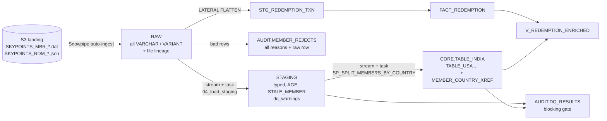

# SkyPoints — Member & Redemption ETL

Solution to the Incubyte Data Engineer assessment. Two daily feeds (a pipe-delimited
member profile file and a JSON partner-redemption feed) are landed, validated, enriched
with **Age** and **Stale_Member**, and split into **one table per country** with
**latest-record-wins** handling for members who move country.

| Layer | What runs at scale (Snowflake) | Executable reference (Python, tested) |
|---|---|---|
| Landing / raw | `sql/01_ddl_raw.sql` — Snowpipe → all-VARCHAR raw tables + streams | `parser.py`, `filename.py`, `legacy.py` |
| Staging + derived cols | `sql/02_ddl_staging.sql`, `sql/04_load_staging.sql` | `staging.py`, `dates.py`, `countries.py` |
| Country split | `sql/03_ddl_targets.sql`, `sql/05_split_countries.sql` | `router.py` |
| JSON redemptions | `sql/06_redemptions.sql` | `redemptions.py` |
| Data validation | `sql/07_validations.sql` + row rules in 04 | `staging.py`, `checks.py` |

The SQL is the production design. The Python package implements the **same rules** so
they can be unit-tested and demoed on a laptop without a warehouse (66 tests), and a
test transpiles the key Snowflake expressions to DuckDB to make sure SQL and Python agree.

---

## Quick start (live demo)

```bash
pip install -r requirements-dev.txt
python -m pytest -q                                   # 66 tests

PYTHONPATH=src python -m skypoints.pipeline \
    --input  data/sample  \
    --legacy data/legacy  \
    --out    out          \
    --as-of  2024-01-15
```

Outputs in `out/`: `TABLE_INDIA.csv`, `TABLE_USA.csv`, … , `MEMBER_REJECTS.csv`,
`REDEMPTION_ENRICHED.csv`, `REDEMPTION_REJECTS.csv`, `dq_report.json`.
The process exits non-zero if any table invariant breaks (member in two tables, etc.).

Or run the scripted demo: `./demo.sh`. It runs:

1. **Day 1**: the brief's sample + legacy extracts → 5 country tables, AUS month-13 reject.
2. **Day 2** (`data/demo_day2/`): Ravi moves **IND → CAN** (removed from `TABLE_INDIA`, logged in
   `moves`), new member with alias `IN`, missing name / month-13 / unknown country `ZZZ`
   rejected, trailer `|T|5` reconciled, `RX10092` goes PENDING → COMPLETED, and a redemption for
   unknown member `999999` shows up as an **orphan**.
3. The same files with the folders passed in reverse order give an identical result.

---

## Architecture



### Key design decisions

1. **Land raw as VARCHAR, type in staging.** A value like `2021-13-13` or `3051985` must
   never fail a billion-row COPY. Typing uses `TRY_TO_DATE`, and a failure becomes a
   *recorded reason*, not a lost row.
2. **Reject rows, not files.** Each bad row goes to `AUDIT.MEMBER_REJECTS` with *every*
   reason it failed (not just the first) and the raw record, so the source can fix it in
   one round-trip and we can replay it. File-level problems (bad header, count mismatch)
   are blocking.
3. **"Latest record wins" = latest *produced* record.** Ordering is
   `(file timestamp from the file name, line number)`. Not `Last_Flight_Date` (optional,
   describes travel not data currency) and not arrival time (changes on re-delivery).
   An older file arriving late is ignored, so results are the same in any arrival order,
   and replaying a file does nothing (tested).
4. **Moves are a one-row lookup.** `MEMBER_COUNTRY_XREF` stores each member's current
   table. A move = delete from the old table + merge into the new one + log to
   `MEMBER_COUNTRY_MOVES`, all in **one transaction** so a member is never in 0 or 2 tables.
5. **Country tables come from one template.** `TABLE_<COUNTRY> LIKE TEMPLATE_COUNTRY_MEMBER`;
   new countries are created by `SP_ENSURE_COUNTRY_TABLES` from the reference table, with
   no hand-written DDL per country. Country aliases live in `REF_COUNTRY_ALIAS`, so ops can add `PHIL → PHL` without a code deploy.
6. **Age and stale flag change over time.** They are stored in staging together with `as_of_date`
   (as the brief asks), *and* recomputed at read time in `V_MEMBER_CURRENT` so
   consumers never read a stale "stale" flag.

### Scale ("billions of records a day")

* **Snowpipe auto-ingest** loads files in parallel as they land, instead of one nightly COPY.
  Source should split extracts into ~100–250 MB compressed files for optimal parallelism.
* **Streams + tasks**: each step reads only the new delta (`APPEND_ONLY` streams); cost is
  proportional to the day's volume, not table size.
* **Set-based only**: no row-by-row loops. The procedure loops over *countries* (tens), never
  members. One `MERGE` per country table per run.
* **Pruning**: raw/staging clustered by load date (and country); targets use search
  optimisation on `member_id` so MERGE probes and point lookups prune micro-partitions.
* **Dedup before merge**: `QUALIFY ROW_NUMBER()` collapses each batch to one row per member,
  so MERGE never sees duplicate source keys (which Snowflake would reject/non-determinise).
* **Change detection by hash**: `record_hash` skips updates when nothing changed, which saves
  writes and avoids rewriting micro-partitions for the (typical) majority of unchanged members.
* The Python reference streams the flat file line by line (constant memory), but it is a
  test oracle and a demo tool. Billions of rows go through the warehouse.

---

## Deliverables → where to look

| # | Ask | Answer |
|---|---|---|
| 1 | DDL: raw, staging, country targets | `sql/01`, `sql/02`, `sql/03` |
| 2 | Staging with Age + Stale_Member (> 90 days since flight) | `sql/04_load_staging.sql`; `dates.py`; `tests/test_dates.py`, `tests/test_sql_logic.py` |
| 3 | Split into country tables, latest-record-wins on moves | `sql/05_split_countries.sql`; `router.py`; `tests/test_router.py` |
| 4 | Flatten JSON + join to members | `sql/06_redemptions.sql`; `redemptions.py`; `tests/test_redemptions.py` |
| 5 | Validations | `sql/07_validations.sql`; `staging.py`, `checks.py`; `tests/test_staging.py` |
| 6 | Live demo | "Quick start" above |

### Age & Stale definitions

* `AGE` = completed years at `as_of_date`, birthday-aware. Plain `DATEDIFF('year')` counts
  calendar boundaries, so someone born 31-Dec would be "1" on 1-Jan. A test covers this,
  and also leap-day births.
* `STALE_MEMBER` = `days_since_flight > 90` (exactly 90 is *not* stale). A member who never flew
  is measured from `enrollment_date`. Someone who enrolled 2 years ago and never flew is
  stale, and leaving the flag NULL would hide them.

### Joining redemptions to members

* Key is `member_id` (the only identifier the partner sends). `txn_id` is the fact key.
  The same txn can re-appear with a new status (PENDING → COMPLETED), and the latest `feed_date` wins.
* `LEFT JOIN` from the fact to `V_MEMBER_CURRENT` so redemptions for not-yet-known members
  surface as **orphans** (DQ check) instead of disappearing.
* Country-scoped queries join `TABLE_<COUNTRY>` directly; `MEMBER_COUNTRY_XREF` says which.
* Member attributes are current-state (type 1). If finance needs *the tier at txn_date*,
  make the country tables SCD-2 and join on `txn_date BETWEEN valid_from AND valid_to`.

---

## Data issues found (and how each is handled)

Found in the brief's own sample and staging table:

| Issue | Evidence | Handling |
|---|---|---|
| Spec marks **Member_Name** as the key, Member_Id as not | spec table | Use **member_id** as business key. Names aren't unique: the legacy files contain two different "Mike"s. Check `SPEC_KEY_MEMBER_NAME_NOT_UNIQUE` makes that visible. **To confirm with the business.** |
| Non-ISO country codes | `PHIL`, `AU` next to `USA`, `IND` | Normalise via `REF_COUNTRY_ALIAS` → `PHL`, `AUS`; warning `COUNTRY_CODE_NORMALISED`. Unknown code → reject (can't be routed). |
| DOB uses a different layout than other dates | DOB `03051985` (MMDDYYYY) vs dates `20101012` (YYYYMMDD) | Separate parser per field. |
| DOB lost its leading zero in staging | `3051985` in the intermediate table | Only a *leading* zero can be lost, so a 7-digit value is a single-digit month. `LPAD(…,8,'0')` is unambiguous; warning `DOB_LEADING_ZERO_RESTORED`. Root cause: a numeric type upstream. Keep dates as strings until parsed. |
| Agent_Name lost between file and staging | every source row has `Sam`, staging shows it only for Elena | Blocking check `COLUMN_VALUES_LOST_RAW_TO_STAGING` compares non-null counts layer to layer. |
| Inconsistent Member_Id lengths | `22345`, `2256` vs 6 digits | Warning `MEMBER_ID_SHORTER_THAN_EXPECTED` (maybe truncation). |
| Post_Code in spec but not in header | spec pos 9 vs sample header | Header-driven parsing (map by name, not position), so an added/missing column can't shift every field after it. Typed as VARCHAR, not INT (leading zeros, Canadian `M5V 3L9`). |
| Header column `County` in staging | intermediate table | Treated as a typo for Country; DDL uses `country_code`. |
| Every row has identical DOB / dates / agent | all `03051985`, `20101012`, `20121013`, `Sam` | Warning `SUSPICIOUS_CONSTANT_COLUMN`: usually an injected default. |
| No trailer record | sample file | Can't prove the file wasn't truncated. **Recommend `|T|<count>`**. The parser already validates it if present; until then we reconcile raw = staged + rejected. |
| Field lengths: State/Country = 5 | `NCR`, `PHIL` | Enforced as warnings; member_id (18) / name (255) are blocking. |

Found in the legacy country extracts (`data/legacy/`):

| File | Issue | Handling |
|---|---|---|
| all three | `ID` = 1, 2, 3 in every file: a row number, not a member id | Namespaced `IND-1`, `USA-1`, `AUS-1`. Used raw, three different people would be merged into one member who "moved country" twice. |
| `USAin.csv` | dates as integers `1052022` (leading zero lost) | `zfill(8)` → `01052022` = 5 Jan 2022. |
| `USAin.csv` | no DOB column | Age = NULL (DOB is optional). |
| `AUS.xlsx` | DOB is the literal string `"NULL"` | Null sentinels (`NULL`, `N/A`, …) → missing, with warning; Snowflake `NULL_IF` does the same. |
| `AUS.xlsx` | Enrollment date `2021-13-13` (month 13) | Mandatory + invalid → **rejected** with the original value in the reason. |
| `INDin.csv` | dates `M/D/YYYY`; extra `Individual or Corporate` column | Parsed; member type kept as `extras`. The unified layout has no column for it yet, so that's **a decision for the business**. |

---

## Validation catalogue

**Blocking** (row → rejects): mandatory missing (name, id, enrollment date) · invalid date in
any date field (present-but-garbage is not "missing") · member_id > 18 chars or illegal
characters · name > 255 · unknown country · column-count mismatch.

**Warning** (row loads, flagged in `dq_warnings`): country normalised · DOB zero restored ·
short member id · unknown tier / active flag · flight before enrollment · DOB not before
enrollment · future dates · age outside 0–120 · null-sentinel strings.

**File / table level** (`AUDIT.DQ_RESULTS`): file-name timestamp parsable · exactly one header,
matching layout · unknown record types · row-count reconciliation (raw = staged + rejected)
· trailer count · volume vs 7-day average · duplicate member_id within a file · member_id with
multiple names · name-as-key uniqueness · member in >1 country table · row in wrong country
table · xref in sync · orphan redemptions · same txn_id for different members · constant
columns · column values lost between layers. A final block raises an exception if any
**blocking** check failed, so the task fails and alerts.

---

## Assumptions (to confirm)

* File naming: `SKYPOINTS_<MBR|RDM>_<YYYYMMDD>_<HHMMSSTT>.<dat|json>` (TT = hundredths). The
  brief says a spec exists but doesn't give it.
* The file-name timestamp is when the source produced the extract.
* `Is_Active` ∈ {A, I}; tiers ∈ {SLV, GLD, PLT}, held in reference tables and easy to extend.
* Target tables hold current state (type 1). SCD-2 is a small change if history is needed.
* Legacy extracts are older than any unified feed, so the demo stamps them `2022-12-31`.

## Repository layout

```
sql/                 Snowflake DDL + transformations, run in order 01 → 07
src/skypoints/       Python reference implementation + CLI
tests/               pytest suite (incl. SQL-vs-Python checks on DuckDB)
data/sample/         feeds exactly as given in the brief
data/legacy/         INDin.csv, USAin.csv, AUS.xlsx
```
